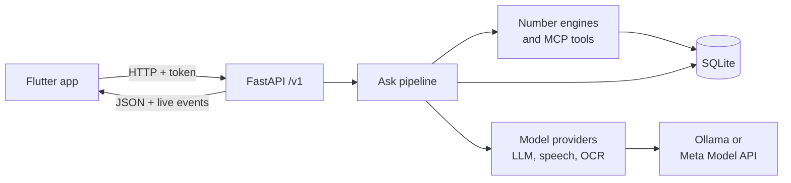

# Kanakku

**A voice-first money adviser for Indian families.** Ask about a loan, a policy, a share tip or a strange phone call, by
voice or text, and show the paper. A council of AI specialists answers with red, yellow or green, one plain sentence and
the questions to ask. Every number is computed by code, never by the AI.

Built for the Meta AI Developer Hackathon (Oct 27 – Nov 4 2026). Decision support, not investment advice.

<p>
  
  
  
</p>

[All screens](docs/screens/)

## For judges

**Built during the hackathon:** every commit from `de71ad7` (28 Oct 2026) to `HEAD`; nothing in this repository is older.

**Use of Meta AI.** Every row was run live; the model id is the one Meta returned, not our setting.

| step | Meta model | setting | why | proof | median time |
|---|---|---|---|---|---|
| Case builder | `muse-spark-1.3` | `json_object`, `minimal` reasoning | classifies the case and copies the terms | [meta_run](docs/reports/meta_run.md) | 2.8–5.5 s |
| Reading photos | `muse-spark-1.3` vision | with OCR | second reading: both must agree for "read twice" | [meta_run](docs/reports/meta_run.md) | in the case builder |
| Council | `muse-spark-1.3` | `json_object`, `minimal` reasoning | each specialist argues from fact ids | [reliability](docs/reports/reliability_meta.md) | 9.6–12.8 s |
| Explainer | `muse-spark-1.3` | `json_object`, `minimal` reasoning | plain spoken lines, checked again by code | [reliability](docs/reports/reliability_meta.md) | 9.9–19.8 s |

Speech-to-text runs on local faster-whisper, not on Meta. `json_schema` mode is not used: on Muse Spark it ran to the token
limit. Effort levels were picked from [this table](docs/reports/effort_matrix.md).

**How numbers are guaranteed.** The model writes `{fact_id}` placeholders and code fills in the value. A line with a digit of
its own is dropped. Each term must be found in the paper, and each figure is recomputed by an
[independent audit](docs/reports/numbers_audit.md): 22 figures, 0 mismatches.

**Privacy.** Discreet is the default: personal figures stay on screen and are never spoken. Tests cover this on every case.

**Evidence.**

| check | result |
|---|---|
| Reliability on Meta, 5 cases × 3 | [15 of 15 as expected](docs/reports/reliability_meta.md), 1 run degraded |
| Framing on Meta, 3 framings × 2 | [no green; one framing gave yellow, not red](docs/reports/reliability_framing_meta.md) |
| Financial calibration, 3 runs each | [calibration table](docs/reports/calibration.md) |
| Full QA report | [qa_final.md](docs/reports/qa_final.md) |

**Verify in 5 minutes, no key needed.** `make demo-replay` runs the 5 demo cases and serves the app from
[recorded real Meta replies](server/demo_assets/replay/), each labelled "replay of recorded Meta call". For a live run:
`make start` (paste a Meta key), `make phone`, `make demo`, then ask:

1. Attach `kanakavalli_brochure.pdf`: "An agent says this plan is guaranteed to give 15 lakh. Should I take it?" Expect Stop.
2. "A finance company is offering me a loan of 1,00,000 at 12% flat for 24 months." Expect Stop or Careful, real rate 21.6%.
3. "A man from the bank called. My KYC has expired and he asks me to tell him the OTP." Expect Stop with no model call.

**Known limits.** Speech is English only, and the phone's microphone path has not been tried with a real voice. The app has no push notifications: guardian alerts appear when the Alerts tab is
opened. A model can vary between runs, so the same case can move between yellow and red; see the calibration table.

**From prototype to product (next steps, not built yet).** Consent-based family data through Account Aggregators. Malayalam
and Hindi speech and app text. Distribution through co-operative banks and families.

**User feedback.** Early reactions, on the local models, are in [user_feedback.md](docs/user_feedback.md).

## Features

- **Code owns the numbers.** Returns, real interest rates, affordability and pump-and-dump signals come from deterministic
  engines. The model may only cite them.
- **Evidence for every claim.** Each amount must be found in the paper, and each number on screen shows its source.
- **Safety rules beat the vote.** Scams, unaffordable offers and unbacked guarantees override the council.
- **Private by default.** A family's own figures are shown on screen and never spoken unless the person is alone.
- **Guardian alerts.** A red answer alerts a family member, who can leave a note.
- **Bounded model use.** At most 4 model calls per question, 20 seconds each, with a visible flag if a step fails.
- **Runs locally or on Meta.** Local Ollama or the Meta Model API, with no code change.
- **Family members and holdings.** Each value has an owner, and another member's money stays out of the family budget unless
  the family says so. Mutual fund, share and SIP statements are read into facts.

## Quick start

Requires Linux with `git`, `curl` and `make`, 10 GB of free disk and 16 GB of RAM.

```bash
git clone <repo-url> kanakku && cd kanakku
make start
```

`make start` installs what it needs, asks for a Meta API key (press Enter to use the local model), and shows a QR code
with a live log. Ctrl+C stops everything.

To install the app, connect an Android phone with USB debugging on and run `make phone`. This needs
[Flutter](https://docs.flutter.dev/get-started/install/linux/android) 3.41 and the Android SDK. With no phone connected,
it prints the `.apk` to send to the phone. In the app, open **Settings → Scan code** and scan the QR code.

| command | what it does |
|---|---|
| `make start` | Set up if needed, start Kanakku, show the live log |
| `make phone` | Build the app and install it on the phone |
| `make demo` | Reset the fictional demo family and print 4 demo questions |
| `make doctor` | Check everything; each problem comes with its fix |
| `make test` | Run the server tests |
| `make stop` | Stop Kanakku if Ctrl+C was not possible |
| `make help` | List every command |

## Architecture



Each question goes through these steps. Only the three marked steps always use the model; the debate runs on disagreement.

| step | what happens |
|---|---|
| Ingest | Voice, photos and PDFs become text and evidence quotes |
| Scam rules | Code spots OTP and KYC scams and answers red at once |
| **Case builder** | The model identifies the case type, terms and seller claims |
| Verify and compute | Each term is checked against the evidence, then code computes the facts |
| **Council** | Specialists argue using fact ids only; unsupported arguments are dropped |
| **Debate** | One rebuttal round, only on disagreement |
| Consensus | Weighted vote, then safety overrides |
| Privacy | Personal figures are kept off the spoken lines |
| **Explainer** | Plain spoken lines, each one checked again |
| Questions | Chosen from a fixed bank per case type |

| specialist | focus |
|---|---|
| **Alfii** | Leads the council and concludes; never votes |
| **Sankz** | Banking: loans, EMIs, fixed deposits, affordability |
| **Dani** | Mutual funds, SIPs, insurance as investment |
| **Vick** | Stocks: pump-and-dump checks; never recommends buying |

## Meta Model API

Paste a key when `make start` asks for it. Kanakku then uses `muse-spark-1.3` at `https://api.meta.ai/v1`, with vision,
in place of the local model. Calls use `json_object` and `minimal` reasoning, which keep each step inside the 20 second limit.
A response cache and a daily cap (`META_MAX_CALLS_PER_DAY`, default 300) protect the credit. `make forget-key` removes the
saved key, and `make meta-run` repeats the live proof.

## Tech stack

| layer | tools |
|---|---|
| App | Flutter, shadcn_ui, provider |
| Server | Python 3.11, FastAPI, Pydantic, SQLite |
| Models | Ollama (`qwen2.5:7b-instruct`) or Meta Model API, faster-whisper, Tesseract |
| Tools | MCP server over the same functions the pipeline uses |

## Project layout

```
app/        Flutter app (Android)
server/     FastAPI server, pipeline, engines, providers, tests
scripts/    Scripts behind the Makefile
docs/       Reports, screenshots
```

## Testing

| suite | command | evidence |
|---|---|---|
| Server: unit, API, end-to-end (offline) | `make test` | 530 tests |
| App: analysis, widgets, screenshots | `make app-test` | [screens](docs/screens/) |
| App on a device against the real server | `make app-integration` | emulator run |
| Real-model reliability | `make reliability` | [Meta](docs/reports/reliability_meta.md) |

## Status

Speech-to-text is English for now. Answers can be in Malayalam and Hindi, but the app's own text is English and native
review is pending. The Meta path has run live on `muse-spark-1.3`. Android is the supported platform, and the app has run on a
real Samsung A73 (Android 16).

## Prior work

All code in this repository was written during the hackathon. The consensus idea, a weighted vote of specialists with
safety overrides, comes from our earlier project **IFA** (patent pending), which is not in this repository; no code was
copied from it. The demo family, brochure, loan offer and share (ZEPHYRX) are fictional.

## Licence

[MIT](LICENSE)
