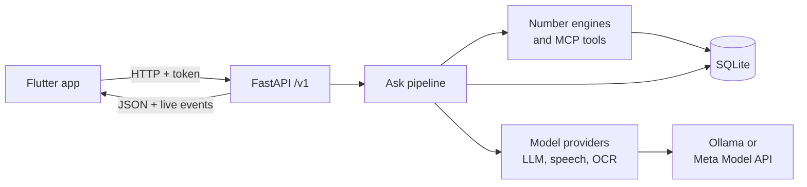

# Kanakku

**A voice-first money adviser for Indian families.** Ask about a loan, a policy, a share tip or a strange phone call, by
voice or text, and show the paper. A council of AI specialists answers with red, yellow or green, one plain sentence and
the questions to ask. Every number is computed by code, never by the AI.

Built for the Meta AI Developer Hackathon (Oct 27 – Nov 4 2026). Decision support, not investment advice.

<p>
  
  
  
</p>

[Demo recording](docs/demo_run.mp4) · [All screens](docs/screens/)

## Features

- **Code owns the numbers.** Returns, real interest rates, affordability and pump-and-dump signals come from deterministic
  engines. The model may only cite them.
- **Evidence for every claim.** Each amount must be found in the paper, and each number on screen shows its source.
- **Safety rules beat the vote.** Scams, unaffordable offers and unbacked guarantees override the council.
- **Private by default.** A family's own figures are shown on screen and never spoken unless the person is alone.
- **Guardian alerts.** A red answer alerts a family member, who can leave a note.
- **Bounded model use.** At most 4 model calls per question, 20 seconds each, with a visible flag if a step fails.
- **Runs locally or on Meta.** Local Ollama or the Meta Model API, with no code change.

## Quick start

Requires Linux with `git`, `curl` and `make`, 10 GB of free disk and 16 GB of RAM.

```bash
git clone <repo-url> kanakku && cd kanakku
make start
```

`make start` installs what it needs, asks for a Meta API key (press Enter to use the local model), and shows a QR code
with a live log. Ctrl+C stops everything.

To install the app, connect an Android phone with USB debugging on and run `make phone`. This needs
[Flutter](https://docs.flutter.dev/get-started/install/linux/android) 3.41 and the Android SDK. With no phone connected,
it prints the `.apk` to send to the phone. In the app, open **Settings → Scan code** and scan the QR code.

| command | what it does |
|---|---|
| `make start` | Set up if needed, start Kanakku, show the live log |
| `make phone` | Build the app and install it on the phone |
| `make demo` | Reset the fictional demo family and print 4 demo questions |
| `make doctor` | Check everything; each problem comes with its fix |
| `make test` | Run the server tests |
| `make stop` | Stop Kanakku if Ctrl+C was not possible |
| `make help` | List every command |

## Architecture



Each question goes through these steps. Only the three marked steps always use the model; the debate runs on disagreement.

| step | what happens |
|---|---|
| Ingest | Voice, photos and PDFs become text and evidence quotes |
| Scam rules | Code spots OTP and KYC scams and answers red at once |
| **Case builder** | The model identifies the case type, terms and seller claims |
| Verify and compute | Each term is checked against the evidence, then code computes the facts |
| **Council** | Specialists argue using fact ids only; unsupported arguments are dropped |
| **Debate** | One rebuttal round, only on disagreement |
| Consensus | Weighted vote, then safety overrides |
| Privacy | Personal figures are kept off the spoken lines |
| **Explainer** | Plain spoken lines, each one checked again |
| Questions | Chosen from a fixed bank per case type |

| specialist | focus |
|---|---|
| **Alfii** | Leads the council and concludes; never votes |
| **Sankz** | Banking: loans, EMIs, fixed deposits, affordability |
| **Dani** | Mutual funds, SIPs, insurance as investment |
| **Vick** | Stocks: pump-and-dump checks; never recommends buying |

## Meta Model API

Paste a key when `make start` asks for it. Kanakku then uses `muse-spark-1.3` at `https://api.meta.ai/v1`, with vision,
in place of the local model. A response cache and a daily cap (`META_MAX_CALLS_PER_DAY`, default 300) protect the credit.
`make forget-key` removes the saved key.

## Tech stack

| layer | tools |
|---|---|
| App | Flutter, shadcn_ui, provider |
| Server | Python 3.11, FastAPI, Pydantic, SQLite |
| Models | Ollama (`qwen2.5:7b-instruct`) or Meta Model API, faster-whisper, Tesseract |
| Tools | MCP server over the same functions the pipeline uses |

## Project layout

```
app/        Flutter app (Android)
server/     FastAPI server, pipeline, engines, providers, tests
scripts/    Scripts behind the Makefile
docs/       Reliability reports, rehearsals, screenshots
```

## Testing

| suite | command | evidence |
|---|---|---|
| Server: unit, API, end-to-end (offline) | `make test` | 414 tests |
| App: analysis, widgets, screenshots | `make app-test` | [screens](docs/screens/) |
| App on a device against the real server | `make app-integration` | [recording](docs/demo_run.mp4) |
| Real-model reliability | `make reliability` | [discreet](docs/reliability_final.md), [full](docs/reliability_full_final.md) |
| Fresh-clone rehearsals | `scripts/rehearsal.py <n>` | [run 1](docs/rehearsal_1.md), [run 2](docs/rehearsal_2.md) |

## Status

Speech-to-text is English for now. Answers can be in Malayalam and Hindi, but the app's own text is English and native
review is pending. The Meta path has been tested against a fake server, not a live key. Android is the supported platform.

## Prior work

All code in this repository was written during the hackathon. The consensus idea, a weighted vote of specialists with
safety overrides, comes from our earlier project **IFA** (patent pending), which is not in this repository; no code was
copied from it. The demo family, brochure, loan offer and share (ZEPHYRX) are fictional.
