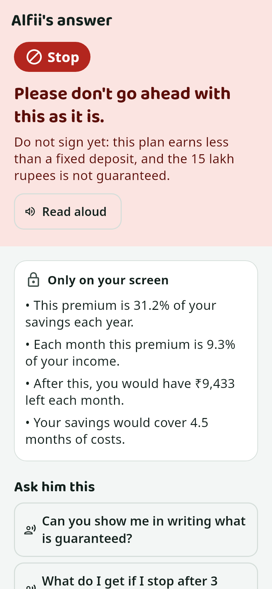
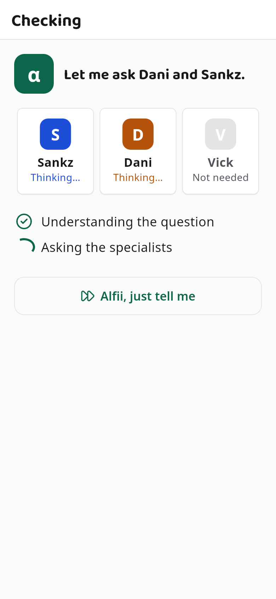
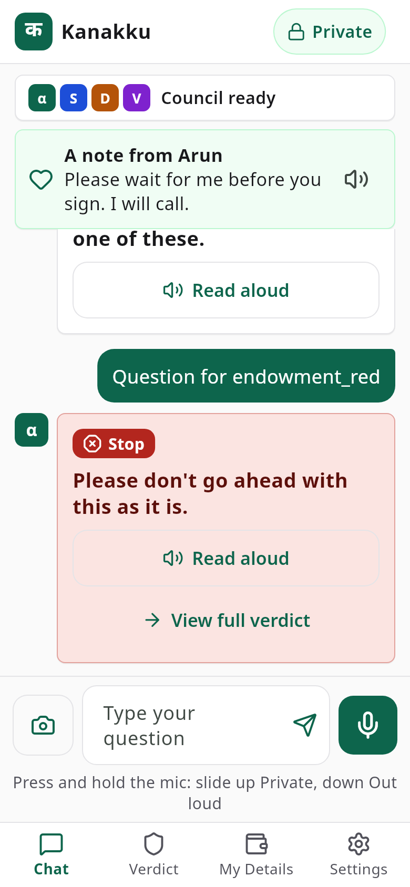

# Kanakku

A voice-first money adviser for ordinary Indian families. Amma asks about a loan, a policy, a share tip or a
strange phone call, by voice or text, and can show the paper. A council of AI helpers answers with
**red / yellow / green**, one plain sentence and the questions to ask. Every number is worked out by code, never by the
AI. Decision support, not investment advice.

<p>
  
  
  
</p>

**Start here: [docs/OWNER_GUIDE.md](docs/OWNER_GUIDE.md)** (no technical background needed).
Technical guide: [docs/GUIDE.md](docs/GUIDE.md). All screens: [docs/screens/](docs/screens/).
A recorded run on an Android emulator: [docs/demo_run.mp4](docs/demo_run.mp4).

Built for the Meta AI Developer Hackathon (Oct 27 – Nov 4 2026).

## Quickstart

```bash
make start      # sets itself up the first time, asks for a Meta key (Enter = the local AI), shows a QR code + live log
                # Ctrl+C stops everything
make phone      # builds the app and installs it on the USB phone (or prints the .apk to send)
make doctor     # checks everything; each ✘ comes with the command that fixes it
make demo       # resets the demo family and prints the 4 demo questions
make test       # server tests
make stop       # safety net if Ctrl+C was not possible
```

`make help` lists these first, then the developer commands. `make start BG=1` starts in the background.

## Switching to the Meta Model API

Run `make start` and paste the key when asked (or `make up PROVIDER=meta` with a saved key). Kanakku then uses
`https://api.meta.ai/v1` (`muse-spark-1.3`, with vision) instead of the local Ollama model; nothing else changes.
A response cache and a daily cap (`META_MAX_CALLS_PER_DAY`, default 300) protect the credit; `make forget-key` removes
the saved key.

## How it works

```
 phone app ──HTTP + token──▶ FastAPI /v1 ──▶ pipeline ──▶ engines + MCP tools ──▶ SQLite
 (Flutter)  ◀──JSON + SSE──                  │
                                             └──▶ model providers: LLM (Ollama | llama.cpp | Meta) · STT (faster-whisper)
                                                                   · OCR (Tesseract) · TTS (on the phone)
```

1. **ingest** voice, photos, PDFs → text and evidence quotes · 2. **scam rules** (code; instant red) ·
3. **case builder** (model call 1) · 4. **verify terms** (every amount found in the evidence) ·
5. **compute** (code: returns, real interest rate, affordability, pump-and-dump signals) · 6. **router** ·
7. **council** (call 2: Sankz, Dani, Vick argue with fact ids only) · 8. **evidence check** (no raw numbers) ·
9. **debate** (call 3, only on disagreement) · 10. **consensus** (weighted vote; safety rules beat the vote) ·
11. **privacy** (own figures never spoken unless alone) · 12. **explainer** (call 4) · 13. **questions** (a fixed bank)

At most 4 model calls per ask, 20 s each, and a visible "degraded" flag if a step fails. Details, the API and a worked
example: [docs/GUIDE.md](docs/GUIDE.md).

## Tests

| | command | evidence |
|---|---|---|
| server: unit, API, end-to-end (offline) | `make test` | 400+ tests |
| `make up` paths vs a fake Meta server | `cd server && ../.venv/bin/python -m pytest tests/test_make_up.py` | key never in any log |
| app: analyze, widgets, screenshots | `make app-test` | [docs/screens/](docs/screens/) |
| app on a device vs the real server | `make app-integration` | [docs/demo_run.mp4](docs/demo_run.mp4) |
| real-model reliability | `make reliability` | [docs/reliability_final.md](docs/reliability_final.md), [full mode](docs/reliability_full_final.md), [model setup](docs/model_setup.md) |
| fresh-clone rehearsals | | [docs/rehearsal_1.md](docs/rehearsal_1.md), [docs/rehearsal_2.md](docs/rehearsal_2.md) |

## Built during the hackathon vs prior work

All code in this repository was written during the hackathon (Oct 27 – Nov 4 2026). The consensus idea (a weighted
vote of specialists with safety overrides) comes from our earlier project **IFA** (patent pending), which is not in
this repository; no code was copied from it. The demo family, brochure, loan offer and share (ZEPHYRX) are fictional.
