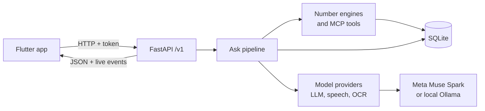

# Kanakku

**A money adviser for Indian families, built on Meta Muse Spark.**

Before you pay for an insurance plan, take a loan, follow a stock tip or answer a strange call, show it to Kanakku. A council
of AI specialists answers red, yellow or green, in one plain sentence, with the exact questions to ask. Every number is
computed by code, never by the AI.

**[▶ Watch the 3-minute demo](https://youtu.be/oabebRENfGs)**

Built for the Meta AI Developer Hackathon (27 Oct – 4 Nov 2026). Decision support, not investment advice.

<p>
  
  
  
</p>

## The problem

In one year, life insurers in India received 26,667 complaints of unfair selling (IRDAI Annual Report 2024-25). Most families
have no adviser to turn to at the moment a seller is sitting in front of them. Kanakku is built for that moment.

## What it does

- **Reads the paper.** Show a brochure, offer or statement as a PDF or photo, and ask your question.
- **Checks it with a council.** Sankz (banking), Dani (funds and insurance) and Vick (stock tips) argue from facts, and Alfii
  concludes, out loud, in different voices.
- **Stops scams at once.** OTP and KYC tricks are caught by rules, with no AI call.
- **Keeps a family in the loop.** A red answer appears in the guardian's view, who can call or leave a note.
- **Knows the whole family.** Each value has an owner. A member's money stays out of the family budget unless the family says
  so, and mutual fund, share and SIP statements become facts.
- **Stays private.** A family's own figures stay on screen and are spoken only when the listener is private.

## Try it in 5 minutes

No key is needed. Replay runs the app on [recorded real Meta replies](server/demo_assets/replay/), and every answer is labelled
"replay of recorded Meta call". You need a Linux laptop, and optionally an Android phone on the same Wi-Fi.

**1. Start it on the laptop**

```bash
git clone https://github.com/<owner>/<repo>.git kanakku && cd kanakku
make demo-replay
```

It installs what it needs, checks the 5 demo cases, then shows a **QR code**, the server address and an access token.

**2. Install the app on the phone**

Download the APK from [Releases](../../releases/latest) and open it on the phone, allowing the install when Android asks. Or
connect the phone by USB and run `make phone`, which needs Flutter.

**3. Connect**

Open Kanakku, tap **Start**, then **Skip all**. Go to **Settings → Scan code** and point the phone at the QR
code. Or type the address and token, then tap **Save and test connection**. It should say "Connected". If it can't connect, run
`make firewall-open`.

**4. Ask**

Type these into the chat exactly, because replay only knows the recorded questions. For the first, send
`server/demo_assets/kanakavalli_brochure.pdf` to the phone (`make phone` copies it for you), then tap the camera button →
**Choose a PDF** and pick it.

| question | expected |
|---|---|
| An agent from the company says this plan is guaranteed to give 15 lakh. Should I take it? | Stop: only 7.5 lakh is written as guaranteed |
| A finance company is offering me a loan of 1,00,000 at 12% flat for 24 months. Should I take it? | Stop or Careful: the real rate is 21.6% |
| A man from the bank called. My KYC has expired and he asks me to tell him the OTP. | Stop, with no model call |

Any other question says "partly checked", because it isn't in the recording. For your own questions and for voice, use
[Run it live](#run-it-live) with a Meta key.

## Using the talk button

The mic button can take a moment to get used to. It isn't a tap: **press and hold it, talk, then let go.**

| you do | what happens |
|---|---|
| Quick tap | A tip reminds you to hold |
| Press and hold, talk, let go | Sends your question, using the setting on the **top-right button** |
| Slide **up** while holding | Private, for this question only: the answer stays on screen |
| Slide **down** while holding | Out loud, for this question only: the council speaks |
| Slide **sideways** while holding | Cancels; nothing is sent |
| Slide back to the middle | Undoes the slide |

The **top-right button** switches your default between Private and Out loud. While you hold the mic, the screen shows what will
happen. Prefer not to talk? Type instead; everything works the same.

## It gets better the more it knows

Kanakku answers for your family, so the more of your details it has, the better the answer. With no details it can still check
an offer, but it can't say what the offer does to your budget. Add income, spending and savings in **My Details**, or show a
salary slip, passbook or statement, and it can work out what you would have left each month and how long your savings would last.

Each detail is yours: it's read back for you to confirm, and it stays on your laptop. Kanakku uses your confirmed details to
compute facts. It doesn't train a model on them.

## Use of Meta AI

Kanakku uses two Meta models and Muse Spark's vision, each where it does something the rest of the system cannot. Every row was
run live, and the model id is the one Meta returned, not our setting.

| step | Meta model | setting | why | proof | median time |
|---|---|---|---|---|---|
| Hearing the question | `muse-voice-transcribe-1.0` | keyword bias for lakh, EMI, KYC and the council's names | hears Indian money words a general model misses | [meta run](docs/reports/meta_run.md) | 3.7 s for a short question |
| Case builder | `muse-spark-1.3` | `json_object`, `minimal` reasoning | classifies the case and copies the terms | [meta run](docs/reports/meta_run.md) | 2.8–5.5 s |
| Reading photos | `muse-spark-1.3` vision | checked against Tesseract | two independent readings: both must agree for "read twice" | [meta run](docs/reports/meta_run.md) | within the case builder |
| Council | `muse-spark-1.3` | `json_object`, `minimal` reasoning | specialists argue from fact ids, as one structured call | [reliability](docs/reports/reliability_meta.md) | 9.6–12.8 s |
| Explainer | `muse-spark-1.3` | `json_object`, `minimal` reasoning | plain spoken lines, checked again by code | [reliability](docs/reports/reliability_meta.md) | 9.9–19.8 s |

**What building on Muse Spark taught us:**

- **Reasoning effort is a real dial.** A reasoning model spent 300 tokens to say "ok". Under a 20 second budget only `minimal`
  gave every expected verdict with nothing degraded, while `low` and `high` timed out ([measurements](docs/reports/effort_matrix.md)).
- **Structured output needs care.** `json_schema` ran to the token limit on the same request that `json_object` finished in
  13 seconds, so the schema stays in the prompt and code validates the reply.
- **Keyword biasing changed the result.** With our word list it heard "Dani and Sankz" where Whisper heard "Ghanian Sanks".
- **The model argues, code decides.** Muse Spark never writes a number, and a safety rule can overrule its vote.

If Muse Voice Transcribe fails, the local Whisper model takes over and the trace says so.

## How it works



| step | what happens |
|---|---|
| Ingest | Voice, photos and PDFs become text and evidence quotes |
| Scam rules | Code spots OTP and KYC scams and answers red at once |
| **Case builder** | The model identifies the case type, terms and seller claims |
| Verify and compute | Each term is checked against the evidence, then code computes the facts |
| **Council** | Specialists argue using fact ids only; unsupported arguments are dropped |
| **Debate** | One rebuttal round, only on disagreement |
| Consensus | Weighted vote, then safety rules that overrule it |
| Privacy | Personal figures are kept off the spoken lines |
| **Explainer** | Plain spoken lines, each one checked again |
| Questions | Chosen from a fixed bank per case type |

Bold steps use the model: at most 4 calls per question, 20 seconds each, with a visible flag if a step fails.

**Numbers cannot be invented.** The model writes `{fact_id}` placeholders and code fills in the value. A line with a digit of
its own is dropped. Each term must be found in the paper, and a comparison such as "higher than a fixed deposit" comes from
code with its condition attached.

The [project guide](docs/PROJECT_GUIDE.md) covers every step, function and setting.

## Evidence

| check | result | report |
|---|---|---|
| Live on Meta | All demo cases answered as expected; in the latest run one council call timed out and the answer was flagged | [meta_run](docs/reports/meta_run.md) |
| Number audit | 22 figures recomputed without our engines, 0 mismatches | [numbers_audit](docs/reports/numbers_audit.md) |
| Calibration on Meta, 3 runs each | Greens 12/12, reds 21/21, yellows 6 yellow and 6 red, no degraded run: no risky case came out green | [calibration](docs/reports/calibration.md) |
| Reliability on Meta, 5 cases × 3 | 15 of 15 as expected, 1 run degraded | [reliability](docs/reports/reliability_meta.md) |
| Framing on Meta, 3 framings × 2 | Never green; one framing gave yellow, not red | [framing](docs/reports/reliability_framing_meta.md) |
| Prompt injection in a brochure | Red 3 of 3; the text is treated as data | [QA report](docs/reports/qa_final.md) |
| Automated tests | 535 server and 70 app tests | `make test`, `make app-test` |
| Real phone | Samsung A73, Android 16: spoken questions, uploads, guardian note, voices, five asks in a row, phone lock, app kill, server loss | [QA report](docs/reports/qa_final.md) |

Every claim is listed with its status in the [claims audit](docs/reports/claims_audit.md). Early reactions, on the local
models, are in [user feedback](docs/user_feedback.md).

## Run it live

Requires Linux with `git`, `curl` and `make`, 10 GB of free disk and 16 GB of RAM.

```bash
make start
```

`make start` installs what it needs, asks for a Meta API key (press Enter to use the local model), and shows a QR code with a
live log. Ctrl+C stops everything. Connect the phone as in [step 3](#try-it-in-5-minutes). If anything looks wrong, `make doctor`
says what to fix.

To build the app yourself, connect an Android phone with USB debugging on and run `make phone`. This needs
[Flutter](https://docs.flutter.dev/get-started/install/linux/android) 3.41 and the Android SDK.

| command | what it does |
|---|---|
| `make start` | Set up if needed, start Kanakku, show the live log |
| `make phone` | Build the app and install it on the phone |
| `make demo` | Reset the fictional demo family and print the demo questions |
| `make demo-replay` | Run on recorded Meta replies, no key needed |
| `make meta-run` | Repeat the live Meta proof |
| `make doctor` | Check everything; each problem comes with its fix |
| `make test` | Run the server tests |
| `make stop` | Stop Kanakku if Ctrl+C was not possible |
| `make help` | List every command |

## Tech stack

| layer | tools |
|---|---|
| App | Flutter, shadcn_ui, provider |
| Server | Python 3.11, FastAPI, Pydantic, SQLite |
| Models | Meta Muse Spark and Muse Voice Transcribe, or Ollama (`qwen2.5:7b-instruct`) and faster-whisper; Tesseract |
| Tools | MCP server over the same functions the pipeline uses |

## Project layout

```
app/        Flutter app (Android)
server/     FastAPI server, pipeline, engines, providers, tests
scripts/    Scripts behind the Makefile
docs/       Project guide, evidence reports, screenshots, user feedback
```

## From prototype to product

Answers improve with more of a family's details, but today the family adds them by hand. And a family's money lives in separate
places: bank statements, policies, loans, demat accounts and old paper files. Each seller sees one piece, and nobody looks at the
whole picture on the family's side. Our vision is a personal AI assistant that keeps that picture in sync with the family's
consent and guides them before each decision.

None of this is built yet. The next steps are consent-based data through Account Aggregators, Malayalam and Hindi speech and
app text, and reaching families through co-operative banks.

## Known limits

- Speech is English only. Transcription can repeat a word or digit ("7.5 5 lakh" in one test); an empty result gets a second
  try on Whisper.
- Answers can be in Malayalam and Hindi, but the app's own text is English and native review is pending.
- There are no push notifications: guardian alerts appear when the Alerts tab is opened.
- A model can vary between runs, so the same case can move between yellow and red.
- A Meta call can pass the 20 second limit. The answer then says "partly checked".
- Android only.

## Prior work

All code in this repository was written during the hackathon. The consensus idea, a weighted vote of specialists with safety
overrides, comes from our earlier project **IFA** (patent pending), which is not in this repository; no code was copied from
it. The demo family, brochure, loan offer and share (ZEPHYRX) are fictional.

## Licence

[MIT](LICENSE)
