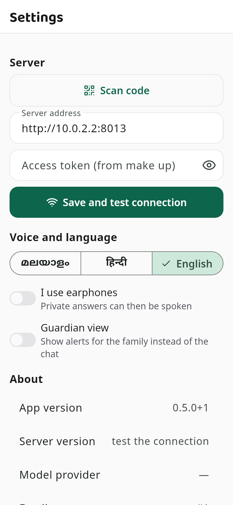
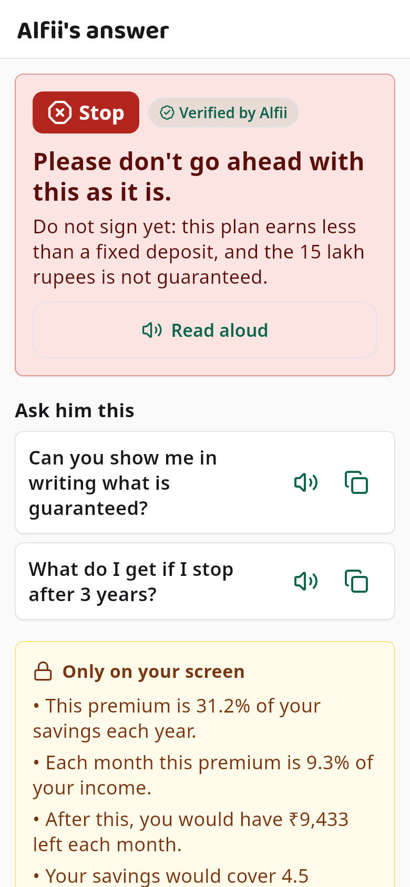

# Kanakku — owner's guide

This guide is for someone with no technical background. Do the steps in order. Each step has one thing to do and
"What you should see" after it. Words that may be new are explained in the glossary at the end (section 10).

---

## 1. What Kanakku is

Kanakku helps an older person check a money offer before saying yes.
She asks a question on her phone, by talking or typing. She can also show the paper she was given.
A small team of helpers checks the offer: Alfii (the leader), Sankz (banks and loans), Dani (savings and insurance)
and Vick (shares).
The answer is a colour and a short sentence: red = stop, yellow = be careful, green = looks fine.
Every number is worked out by the laptop, not guessed.

**What you need**

- A laptop with Linux Mint (this guide uses Linux Mint 22). It runs Kanakku.
- An Android phone. It shows the app.
- The same Wi-Fi for both.
- A USB cable for the phone (only to put the app on it).

---

## 2. The first time (about 30 minutes, mostly waiting for downloads)

### 2.1 Open the terminal

Press **Ctrl + Alt + T** on the keyboard.

*What you should see:* a window with a blinking cursor. This is the terminal. You will paste commands into it.
To paste, press **Ctrl + Shift + V**. After pasting, press **Enter**.

> To stop a command, press **Ctrl + C**. **Never press Ctrl + Z**: it only pauses the command, and a paused AI makes
> everything after it hang.

### 2.2 Install three small tools

Paste this and press Enter. Type your laptop password when asked (the letters do not show; that is normal).

```bash
sudo apt update && sudo apt install -y git curl make
```

*What you should see:* many lines scroll past, ending without the word "Error".

### 2.3 Download Kanakku

Use the link of the project you were given (it looks like https://github.com/…/kanakku):

```bash
git clone THE-LINK-YOU-WERE-GIVEN ~/kanakku
```

*What you should see:* "Cloning into …" and then "done".

### 2.4 Run Kanakku and follow what it asks

```bash
cd ~/kanakku
```

```bash
make start
```

The first time it sets everything up by itself. It tells you what it is doing:

- "Setting up Kanakku's server parts": wait a few minutes.
- "Kanakku needs to install system packages; you may be asked for your password once": type your laptop password.
- "Meta Model API key (press Enter to use the local models):": press **Enter** (section 5 explains the key).
- "Installing Ollama": this runs the AI on your laptop. Type your password if asked.
- "Downloading it now (about 4.7 GB)": wait; this is the AI itself.

*What you should see:* a square made of blocks (a QR code) and a box that says **"Kanakku is running."**
Below it, new lines appear whenever the app talks to the laptop.

If it stops with a ✘, run `make doctor` in a new terminal. It says what is wrong and which command fixes it.

---

## 3. Every day

### 3.1 Start Kanakku

```bash
cd ~/kanakku
```

```bash
make start
```

Press **Enter** at the key question to use the AI on this laptop (free), or paste your Meta key (section 5).
It takes a few seconds. Leave this window open while you use Kanakku.

*What you should see:* the QR code and the box **"Kanakku is running."**

### 3.2 Connect the phone (the first time, or when the Wi-Fi changes)

Open the Kanakku app, then the **Settings** tab at the bottom. Tap **Scan code** and point the phone at the
square on the laptop. Or type the **Server address** and **Access token** from the box and tap
**Save and test connection**.

*What you should see:* "Connected ✔ Provider: local …".



### 3.3 Stop Kanakku

Click the terminal window and press **Ctrl + C**.

*What you should see:* "Kanakku stopped". Closing the window also stops it.

If that was not possible (the window is gone but the app still connects), open a new terminal and run:

```bash
cd ~/kanakku && make stop
```

---

## 4. Putting the app on your phone

### Install the tools that build the app (once)

1. Open https://developer.android.com/studio in the browser and click **Download Android Studio** (Linux).
2. Open your **Downloads** folder, right-click the file and choose **Extract Here**.
3. In the terminal paste (it starts Android Studio):

   ```bash
   ~/Downloads/android-studio/bin/studio.sh
   ```

4. Click **Next** on every screen, then **Finish**. Wait until the downloads end. Close Android Studio.
5. Install Flutter:

   ```bash
   git clone https://github.com/flutter/flutter.git -b stable ~/flutter && echo 'export PATH="$HOME/flutter/bin:$PATH"' >> ~/.bashrc
   ```

6. Close the terminal and open a new one. Accept the Android licences (press **y** and Enter each time it asks):

   ```bash
   flutter doctor --android-licenses
   ```

*What you should see:* at the end, "All SDK package licenses accepted".

### The USB way (easiest)

1. On the phone: **Settings → About phone →** tap **Build number** 7 times. It says "You are now a developer".
2. **Settings → System → Developer options →** turn on **USB debugging**.
3. Connect the phone to the laptop with the USB cable. On the phone tap **Allow** when it asks about USB debugging.
4. In a terminal:

   ```bash
   cd ~/kanakku && make phone
   ```

*What you should see:* "✔ Installed on the phone" and "✔ Demo brochure copied to the phone's Download folder".
Open **Kanakku** on the phone.

### The "send the file" way (no cable)

1. Run `make phone` without a phone connected. It prints the path of a file ending in `.apk`.
2. Send that file to yourself on WhatsApp, or put it on Google Drive.
3. On the phone, tap the file. When asked, allow **Install unknown apps** for WhatsApp (or Drive), go back and tap
   **Install**.

*What you should see:* the Kanakku icon on the phone.

---

## 5. Using the Meta API

**What the key is:** a secret code from Meta that lets Kanakku use Meta's AI on the internet instead of the AI on the
laptop. It is often faster and can read photos well. It costs money from your credit, so keep it secret.

**Where to get it:** the Meta developer page of the hackathon → your app → **API keys** → **Create key**. Copy it.

**Using it:** run `make start`. When it asks for the key, paste it (it stays hidden) and press Enter.
It checks the key. Then it asks "Save this key for next time? [y/N]". Type **y** to not paste it again.

**If the key is rejected:** it says "key rejected" and asks "Use local models instead? [Y/n]". Press Enter to carry on
with the laptop AI.

**Stop using it:**

```bash
make forget-key
```

Then stop Kanakku with Ctrl + C, run `make start` again and press Enter at the question.

**How your $150 credit is protected:** Kanakku remembers answers it already got, so the same question twice costs
nothing the second time. It also stops after 300 Meta calls in a day (one question uses at most 4). At 240 calls it
writes a warning; at 300 it says so in the app and you can switch to the laptop AI.

---

## 6. Trying it

This resets the pretend family and shows the four questions. Kanakku can be running; use a second terminal:

```bash
cd ~/kanakku && make demo
```

| question (type it, or hold the talk button and say it) | what the answer should look like |
|---|---|
| Tap the camera button next to the text box → **Choose a PDF** → `kanakavalli_brochure.pdf`, then type: "An agent from the company says this plan is guaranteed to give 15 lakh. Should I take it?" | **Stop** (red). Dani and Sankz speak. "Ask him this: How much is guaranteed in writing?" A box "Only on your screen". |
| "A finance company is offering me a loan of 1,00,000 at 12% flat for 24 months. Should I take it?" | **Stop** or **Careful**. Sankz: it really costs about 21.6 percent a year. |
| "I got this message: ZEPHYRX LTD - BIG NEWS COMING! Target Rs. 180 in 2 weeks. Upper circuit guaranteed. Should I put 1 lakh in it?" | **Stop**. Vick: it rose 222 percent in 30 trading days; that is how pump-and-dump schemes look. |
| "A man from the bank called. My KYC has expired and he asks me to tell him the OTP." | **Stop** at once: "No real bank ever asks for your OTP or PIN." |



**Answers:** a typed or Private question stays silent on the screen; tap **View full verdict**, then **Hear the council**. Slide the mic down (Out loud) and the helpers speak by themselves.

**Papers:** the **My Details** tab lists every paper you showed and what kind it is (Insurance, Loan…). Kanakku remembers it, so you can ask about it again later.

**Under the hood:** press and hold the word **Kanakku** at the top of the app. It shows how the answer was made.

---

## 7. If something goes wrong

Always start with:

```bash
make doctor
```

| What you see | What to do |
|---|---|
| A command hangs, or `make doctor` says Ollama is frozen | Close the terminal window, open a new one, then run `killall -9 ollama`, `cd ~/kanakku` and `make start`. Stop commands with Ctrl + C, never Ctrl + Z. |
| The phone says "I can't reach the server" | Phone and laptop on the same Wi-Fi? Look at the box in the `make start` window; scan the code again in Settings. Still no: `make firewall-open`. |
| The app says the access token is wrong | In Settings tap **Scan code** and scan the square again. |
| The app says "server not found" after a few days | The laptop's Wi-Fi address changed. Run `make start` and scan the code again in Settings. |
| Answers are very slow (more than a minute) | The laptop AI is busy or the laptop is weak. Close other programs, or use the Meta key (section 5). |
| No voice | Turn up the phone volume. In the phone settings, check that a "text-to-speech" engine is installed (Settings → Accessibility → Text-to-speech). |
| "key rejected" for the Meta key | Press Enter to carry on with the laptop AI, or run `make forget-key`, then `make start` and paste a new key. |
| The laptop was restarted | Open the terminal, `cd ~/kanakku`, `make start`. |
| The Wi-Fi changed | Same as "server not found": scan the new code in Settings. |
| Kanakku says it is already running | It is open in another terminal. Use that window, or run `make stop` and start again. |

---

## 8. Recording the demo video (about 5 minutes)

| minute | do this |
|---|---|
| before | `make start`, then `make demo` in a second terminal. Phone on the same Wi-Fi. Phone in "Do not disturb". Volume up. |
| 0:00 | Show the app's first screen: "Hello, I'm Alfii". Say what Kanakku is in one sentence. |
| 0:30 | Question 1 with the brochure. Show the checking screen with the helpers. |
| 1:30 | The red answer. Tap **Hear the council**. Tap **Why?** to show where each number came from. |
| 2:30 | Question 4 (the OTP call): the instant red answer. |
| 3:00 | Question 3 (shares tip): Vick's warning. |
| 3:30 | Hold the word Kanakku: "Under the hood". |
| 4:00 | Settings tab → Guardian view → Alerts tab → **Note for Amma**. Switch it off: "A note from Arun". |
| 4:45 | End: "Every number is worked out by code; Kanakku never tells you to buy shares." |

---

## 9. How it works, in plain words

Alfii listens to the question and decides which helpers are needed: Sankz for banks and loans, Dani for savings and
insurance, Vick for shares. Only the helpers that are needed speak.

The AI is good with words but can get numbers wrong. So Kanakku never lets the AI make a number. The laptop reads the
amounts from the paper twice, does the sums itself, and the helpers may only point to those numbers. Any sentence with
a number that was not worked out by the laptop is thrown away.

Some rules are stronger than the helpers' opinion: a request for an OTP is always red; if an offer would leave less
than a month of savings, it is red.

Your own money (income, savings, loans) is never spoken out loud unless you say you are alone or use earphones.
It is shown only on your screen.

For technical people: [GUIDE.md](GUIDE.md).

---

## 10. Glossary

| word | meaning |
|---|---|
| server | the part of Kanakku that runs on the laptop and does the checking |
| app | the part on the phone that you look at and talk to |
| API key | a secret code that lets Kanakku use Meta's AI over the internet |
| Wi-Fi address | the laptop's number on your Wi-Fi, like `http://192.168.1.10:8013`; the phone uses it to find the laptop |
| terminal | the window where you paste commands (Ctrl + Alt + T) |
| command | one line you paste into the terminal and run with Enter, like `make start` |
