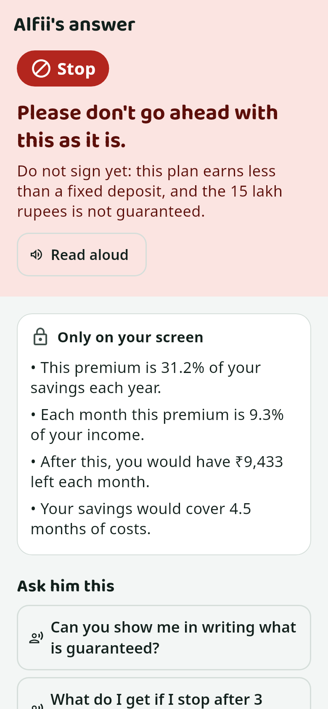

# Kanakku: project guide

The technical guide to Kanakku: what it does, how to run it, how it is built, and which functions run at each step. For a
short overview, start with the [README](../README.md).

**Contents**

1. [What Kanakku is](#1-what-kanakku-is)
2. [How to run it](#2-how-to-run-it)
3. [Architecture](#3-architecture)
4. [What `make start` does](#4-what-make-start-does)
5. [One question, end to end](#5-one-question-end-to-end)
6. [The pipeline, step by step](#6-the-pipeline-step-by-step)
7. [Council, vote and safety rules](#7-council-vote-and-safety-rules)
8. [The number engines](#8-the-number-engines)
9. [Checks that keep the model honest](#9-checks-that-keep-the-model-honest)
10. [Model providers](#10-model-providers)
11. [Database](#11-database)
12. [API reference](#12-api-reference)
13. [The Flutter app](#13-the-flutter-app)
14. [Configuration](#14-configuration)
15. [Command reference](#15-command-reference)
16. [Testing](#16-testing)
17. [Releasing the app](#17-releasing-the-app)
18. [Troubleshooting](#18-troubleshooting)
19. [Demo walkthrough](#19-demo-walkthrough)
20. [Status and open items](#20-status-and-open-items)
21. [Glossary](#21-glossary)

---

## 1. What Kanakku is

Kanakku is a voice-first money adviser for ordinary Indian families. An older person ("Amma") asks about a loan, a
policy, a share tip or a strange phone call, by voice or text, and can show the paper. A council of AI specialists
answers with a **red / yellow / green** verdict, one plain sentence, up to three questions to ask the seller, and a short
spoken line from each specialist. It is decision support, not investment advice.

**The rules the whole design follows**

| rule | where it is enforced |
|---|---|
| Every number comes from code, never from the model | `engines/`, `pipeline/evidence.py` |
| Every claim is tied to evidence | `verify_terms.py`, `claims.py`, `evidence.py` |
| Safety rules beat the vote | `consensus.py` (`overrides_for`, `apply_overrides`) |
| Personal figures are not spoken unless the person is alone | `privacy.py`, discreet mode by default |
| At most 4 model calls per ask, 20 s each, visible `degraded` flag on failure | `providers/llm.py` (`AskBudget`), `run.py` (`_Run.step`) |
| Engine maths, weights, thresholds and overrides are not tuned, and prompts are never tuned to force a colour | project rule |

**Demo story.** An agent tells Lakshmi a plan is "guaranteed to give 15 lakh". She shows the brochure and asks. Alfii
calls Dani and Sankz. Code reads the brochure twice and works out the real yearly return (3.75 % at the lower bonus rate,
below a 7 % fixed deposit). Only 7.5 lakh is guaranteed. The council says **Stop**, gives her the questions to ask the
agent, puts a note about her budget only on her screen, and alerts her son Arun, who leaves her a note. The family,
brochure, loan offer and share (ZEPHYRX) are all fictional.

---

## 2. How to run it

### 2.1 What you need

| | needed | notes |
|---|---|---|
| OS | Linux (tested on Linux Mint 22.3 / Ubuntu 24.04 base) | macOS works for the server; system package install uses apt |
| Basics | `git`, `curl`, `make` | `sudo apt install -y git curl make` |
| Python, uv, Tesseract, ffmpeg, adb, Ollama | installed by `make start` | asks for your password once |
| Flutter 3.41 + Android SDK | only to build the app | see 2.4 |
| Disk | 10 GB free | model 4.7 GB, whisper about 1.5 GB, Flutter build cache |
| Memory | 16 GB RAM; GPU with 6 GB+ VRAM recommended | measured on an RTX 5050 8 GB: 25 tok/s; see section 10 |
| Phone | Android, same Wi-Fi as the laptop, or a USB cable | Android only for now |

> In a terminal, stop commands with **Ctrl+C**. Never use **Ctrl+Z**: it only pauses the command, and a paused Ollama
> holds its port without answering, so everything after it hangs.

### 2.2 First time

```bash
git clone <repo-url> ~/kanakku
cd ~/kanakku
make start
```

`make start` sets itself up and tells you what it is doing:

1. "Setting up Kanakku's server parts": wait a few minutes.
2. "Kanakku needs to install system packages": type your laptop password.
3. "Meta Model API key (press Enter to use the local models):": press **Enter**, or paste a key (2.6).
4. "Installing Ollama" and "Downloading it now (about 4.7 GB)": wait.

You should see a QR code and a box saying **Kanakku is running.** Below it is the live log. If it stops with ✘, run
`make doctor` in a second terminal; each problem comes with the command that fixes it.

### 2.3 Every day

```bash
make start                  # foreground: setup check, provider, AI, server, USB tunnel, QR code, live log
make start PROVIDER=local   # skip the question (PROVIDER=meta uses the saved key, or asks once)
make start BG=1             # background; stop it with make stop
make stop                   # safety net from another terminal
```

**Ctrl+C**, or closing the terminal, stops the server, the AI if Kanakku started it, and the USB tunnel, then prints
"Kanakku stopped". A second `make start` while one runs shows the box again and does not take over.

### 2.4 Put the app on the phone

Install the build tools once:

1. Download Android Studio from https://developer.android.com/studio, extract it, run
   `~/Downloads/android-studio/bin/studio.sh`, click Next through to Finish, wait for the downloads, close it.
2. Install Flutter and accept the licences (open a new terminal between the two commands):

   ```bash
   git clone https://github.com/flutter/flutter.git -b stable ~/flutter && echo 'export PATH="$HOME/flutter/bin:$PATH"' >> ~/.bashrc
   flutter doctor --android-licenses
   ```

**By USB (easiest).** On the phone, tap Settings → About phone → Build number 7 times, turn on Developer options → USB
debugging, plug in the cable and tap Allow. Then:

```bash
make phone      # builds a release APK, installs it, copies the demo brochure to the phone's Download folder
```

**Without a cable.** Run `make phone` with no phone connected. It prints the `.apk` path. Send that file to the phone
(WhatsApp to yourself, or Drive), tap it and allow "Install unknown apps".

### 2.5 Connect the phone

Open the app → **Settings** tab → **Scan code**, and point it at the QR code. Or type the Server address and Access token
from the box and tap **Save and test connection**. You should see "Connected ✔ Provider: local …".

- Wi-Fi: phone and laptop on the same network. `make firewall-open` if the phone cannot reach the server.
- USB: `make start` sets up `adb reverse`, so `http://127.0.0.1:8013` also works.
- The QR code holds `kanakku://connect?url=…&token=…`.

### 2.6 Using the Meta API

Get a key from the hackathon's Meta developer page (your app → API keys → Create key). Run `make start`, paste it at the
hidden prompt, and answer `y` to "Save this key for next time?". The key is checked with one `GET /v1/models` call. If it
is rejected or you are offline, it says so and asks "Use local models instead? [Y/n]". It never starts half-configured.

| changes | stays the same |
|---|---|
| `LLM_BASE_URL=https://api.meta.ai/v1`, `LLM_MODEL=muse-spark-1.3`, vision on, local Ollama not started | pipeline, engines, every check, speech-to-text (local faster-whisper), OCR, the app |

**Credit protection (Meta only).** Identical prompts come from a SQLite cache (`LLM_CACHE=true`). Calls are capped by
`META_MAX_CALLS_PER_DAY` (default 300; one question uses at most 4). At 80 % the log warns. At the cap an ask fails with
`429 daily_limit`, or, with `LLM_FALLBACK=local`, the local models answer and the app shows a "local fallback" badge.

`make forget-key` deletes the saved key. `make meta-check` runs one endowment case against the real API, and skips if no
key is present. `make meta-run` runs the demo cases and writes [docs/reports/meta_run.md](reports/meta_run.md).

**No key?** `make demo-replay` runs the 5 demo cases and serves the app from real Meta replies recorded in
`server/demo_assets/replay/`. Every answer is labelled "replay of recorded Meta call". A question outside the recording
fails its step rather than inventing an answer.

### 2.7 The talk button

Press and hold the mic, talk, then let go. A quick tap only shows a tip. The top-right button sets the default, Private or Out
loud, and a slide changes it for that one question: up for Private, down for Out loud, sideways to cancel, back to the middle to
undo. The screen shows what will happen while you hold. `app/lib/widgets/talk_button.dart` holds the gesture.

Replay answers typed demo questions only. Voice needs `make start`.

### 2.8 Better answers from more details

Personal facts come from what the family confirmed in My Details, typed, spoken or read from a paper. With none, Kanakku still
checks the offer; affordability facts such as `surplus_after` and `buffer_months_after` stay unknown, never zero. With them, the
budget checks and the safety rules can run. Details stay on the laptop and no model is trained on them.

### 2.9 Try it

`make demo` resets the demo family and prints the four questions. Kanakku can stay running; use a second terminal.

| question | expected |
|---|---|
| Camera button → Choose a PDF → `kanakavalli_brochure.pdf`, then: "An agent from the company says this plan is guaranteed to give 15 lakh. Should I take it?" | **Stop**. Dani and Sankz speak. "How much is guaranteed in writing?" A box "Only on your screen" |
| "A finance company is offering me a loan of 1,00,000 at 12% flat for 24 months. Should I take it?" | **Stop** or **Careful**. Sankz: really about 21.6 percent a year |
| "I got this message: ZEPHYRX LTD - BIG NEWS COMING! Target Rs. 180 in 2 weeks. Upper circuit guaranteed. Should I put 1 lakh in it?" | **Stop**. Vick: rose 222 percent in 30 trading days |
| "A man from the bank called. My KYC has expired and he asks me to tell him the OTP." | **Stop** at once, no model call |



---

## 3. Architecture

```
 Flutter app (Android)                             laptop (one machine)
 ┌─────────────────────────┐  HTTP + Bearer token  ┌────────────────────────────────────────────────────────┐
 │ Chat · Verdict          │ ────────────────────▶ │ FastAPI /v1 (request id, token, limits, one error form)│
 │ My Details · Settings   │ ◀─── JSON + SSE ───── │   │                                                    │
 │ Working · Council · Why │                       │   ▼  pipeline (server/app/pipeline/run.py)             │
 │ Under the hood · Guardian│                      │  ingest → scam_rules → case_builder → verify_terms →   │
 └─────────────────────────┘                       │  compute → router → council → evidence → debate →      │
                                                   │  consensus → privacy → explainer → questions → save    │
                                                   │   │                 │                                  │
                                                   │   ▼                 ▼                                  │
                                                   │ engines/ + mcp_server/tools.py     providers/          │
                                                   │   │                                 llm ───────────────┼─▶ Ollama / llama.cpp
                                                   │   ▼                                 stt (whisper)      │   or Meta Model API
                                                   │ SQLite (WAL, migrations, backups)   ocr (tesseract)    │
                                                   └────────────────────────────────────────────────────────┘
```

Text-to-speech runs on the phone. The server only sends the text.

| folder | what it holds |
|---|---|
| `server/app/main.py` | FastAPI app: `create_app`, `lifespan` (settings check, logging, migrations, backups, graceful shutdown) |
| `server/app/config.py` | `Settings` and `get_settings`: every environment variable |
| `server/app/api/` | endpoints (`cases`, `families`, `items`, `alerts`, `health`), `middleware.py`, `errors.py`, `uploads.py`, `deps.py` |
| `server/app/pipeline/` | the ask pipeline, one file per step; `run.py` drives it |
| `server/app/engines/` | deterministic maths: `finance.py`, `tip_signals.py`, `compare.py`, `fact.py` |
| `server/app/numbers/` | Indian number parser (lakh, crore, ₹1,50,000) |
| `server/app/providers/` | `llm.py`, `guard.py`, `stt.py`, `ocr.py`, `tts.py` |
| `server/app/mcp_server/` | `tools.py` (shared by the pipeline) and `server.py` (FastMCP wrapper, `make run-mcp`) |
| `server/app/db/` | `repo.py`, `migrations/`, `migrate.py`, `backup.py`, `seed_demo.py` |
| `server/app/prompts/prompts.py` | all prompts: `CASE_BUILDER`, `COUNCIL`, `DEBATE`, `EXPLAINER`, `REWRITE` |
| `server/app/core/` | `context.py` (request id), `logs.py` (JSON logs, secret redaction) |
| `server/data/` | `reference_rates.json` (FD, inflation and index assumptions) |
| `server/demo_assets/` | fictional brochure, `stocks/*.csv` price history, `owner_docs/` (6 sample family papers), `replay/` (recorded Meta replies) |
| `server/tests/` | 535 offline tests; `fakes/` (scripted LLM, fake Meta server), `fixtures/llm/`, `calibration/` (scenarios, independent oracle, number audit) |
| `server/scripts/` | `reliability.py`, `export_app_fixtures.py`, `meta_key.py`, `meta_live_check.py`, `check_models.py`, `print_qr.py`, `make_demo_assets.py` |
| `app/lib/` | Flutter app: `core/`, `state/`, `screens/`, `widgets/`, `theme.dart` |
| `app/test/`, `app/integration_test/` | widget and screenshot tests; on-device tests |
| `scripts/` | shell scripts behind the Makefile |
| `docs/` | this guide, `reports/` (evidence), `screens/`, user feedback |
| `dist/` | release APKs and `RELEASES.md` (git-ignored, local only) |
| `run/` | runtime only (git-ignored): pids, `server.log`, backups, stamps |

---

## 4. What `make start` does

Call chain, in order:

```
make start
└─ scripts/start.sh
   ├─ alive run/start.pid?  → already running: box(), exit
   ├─ scripts/setup.sh                    (under 2 s when nothing changed)
   │    create .env · install uv · build .venv if server/pyproject.toml hash ≠ run/setup.stamp
   │    seed the demo family if no database · install missing system packages
   ├─ trap cleanup INT TERM HUP
   ├─ scripts/up.sh
   │    choose provider → check key (server/scripts/meta_key.py) → write KANAKKU_TOKEN to .env.local
   │    local only: install Ollama, pull model, start backend → launch uvicorn app.main:app → wait for /health
   ├─ reverse_tunnels()                   adb reverse for connected phones (lib.sh phones_for_reverse)
   ├─ box()                               server/scripts/print_qr.py + "Kanakku is running"
   ├─ scripts/log_view.py run/server.log  live coloured log
   └─ sleep 1 loop while the server lives
        cleanup(): kill viewer → scripts/down.sh → remove_reverse → rm start.pid → "Kanakku stopped"
```

**Provider choice in `up.sh`**, first match wins: `PROVIDER=` on the command line → a saved `META_API_KEY` (environment or
`.env.local`) → a hidden prompt in a terminal → local (CI and `make smoke`).

**Why the loop is `sleep 1` and not `wait`:** a trap inside `wait` deadlocked when the terminal hung up. The loop also
checks that the TTY still exists, so a vanished terminal cannot leave orphans.

**Server start-up** (`main.py`): `create_app` → `errors.install` → `middleware.install` → routers under `/v1` plus old
unversioned aliases. Then `lifespan`: `load_settings` (prints what is wrong without values and exits on a bad config) →
`setup_logging` (with secrets to redact) → `get_repo` (opens SQLite, runs migrations) → background `_backups` loop
(hourly check, one copy a day, keep 3). On shutdown, `_drain` lets running asks finish for up to 15 s.

**Shared helpers in `scripts/lib.sh`:** `envget`, `envlocal_set`, `envlocal_del`, `interactive`, `lan_ip`, `alive`,
`stop_pid`, `launch`, `http_ok`, `url_frozen` (detects a paused Ollama), `phones_for_reverse`, `remove_reverse`.

**Files the runtime writes:** `.env` (settings), `.env.local` (mode 600: `META_API_KEY`, `KANAKKU_TOKEN`), `run/server.pid`,
`run/llm.pid`, `run/start.pid`, `run/server.log`, `run/backups/`, `run/setup.stamp`, `run/system.declined`,
`run/adb_reverse`, `run/demo.reset`.

---

## 5. One question, end to end

This is the real call path when someone types a question and taps send.

```
APP
ChatPage._send(AskRequest)                              app/lib/screens/home.dart
└─ WorkingScreen._go()                                  app/lib/screens/working.dart
   └─ CaseProvider.ask() → _run(entry)                  app/lib/state/cases.dart
      ├─ ApiClient.startAsk()   POST /v1/cases  wait=false, Idempotency-Key
      ├─ _follow()              ApiClient.events()   GET /v1/cases/{id}/events (SSE)
      └─ _result()              ApiClient.caseBundle()  GET /v1/cases/{id}, polled until `result` exists

SERVER
middleware._guard                                       request id, then _handle: token, size, rate limit, timeout
└─ api/cases.py ask()
   ├─ require_family
   ├─ repo.idempotent_case    → same key seen: _replay() and stop
   ├─ _upload + upload_limits.check_all                 size and real file type
   ├─ guard.exhausted?        → 429 daily_limit (Meta, no fallback)
   ├─ repo.create_case → repo.claim_idempotency
   └─ asyncio.create_task(run_pipeline(...)) → 202 {"case_id", "status": "running"}

pipeline/run.py run_pipeline()
├─ AskBudget(4) + use_budget(budget)
├─ _pipeline()                                          steps in section 6
│    each step: `async with run.step(name)` → publishes step_started / step_finished,
│    writes a trace row, and on failure marks the step degraded and carries on
├─ any crash → a yellow "Something went wrong" CaseResult, degraded=True
├─ repo.update_case(status="done", result_json=…)
└─ bus.publish(DONE)                                    ends the SSE stream

APP
WorkingScreen → VerdictScreen(result, autoplayCouncil)  autoplay only when out loud or with earphones
```

**Offline path.** `CaseProvider.ask` sees `online == false`, or `_run` gets an offline `ApiException` before a case id
exists. `_enqueue` stores the request. When the network returns it is sent again with the same `Idempotency-Key`, so the
server never answers one question twice.

**If live progress fails**, `_follow` swallows the error and `_result` still fetches the answer. Progress is a nicety.

---

## 6. The pipeline, step by step

All of this is in `_pipeline()` in `server/app/pipeline/run.py`. Model calls are marked **LLM**.

| # | step | functions called | what happens |
|---|---|---|---|
| 1 | ingest | `ingest.ingest` → `_kind`, `_pdf_pages`, `_docx_text`, `_ocr` → `ocr.ocr_image`; `stt.transcribe`; `repo.add_evidence` | Audio → transcript, photos → OCR, PDF/DOCX → text. Evidence stored with ids (`q12`). Aadhaar, PAN and account numbers stripped. `decide_mode` sets the privacy mode. `repo.family_documents` loads known papers |
| 2 | scam_rules | `scam_rules.detect` → `_scam_result` | OTP, KYC, "pay to receive" signals → red at once, no model call. The paper is remembered as `scam_or_payment_request` |
| 3 | case_builder **LLM 1** | `llm.chat_json(prompts.CASE_BUILDER, …, CaseDraft)`, `flags.routing_flags`, `remember` | Case type, terms with exact words, seller claims, ticker. Uses vision when on; a failed vision call falls back to OCR text ("read once"). A stored paper type replaces `unknown` / `general_money`. `unknown` → `_simple_result` asks one clarifying question; `out_of_scope` ends here |
| 4 | verify_terms | `verify_terms.verify_terms` → `verify_term`, `fuzzy_contains`, `_number_in`; `repo.add_term` | Each term must be found in the evidence. Unverified terms stay out of the maths and become questions |
| 5 | compute | `compute.compute_facts` → `mcp_server.tools.*`; `repo.save_facts`; `claims.check_claims` | Facts from code. Seller claims checked against facts and quotes |
| 6 | router | `router.route`; `templates.opener` | Picks the specialists. Publishes `alfii_opener` and `agent_called`, so Alfii speaks while the council works |
| 7 | council **LLM 2** | `council.council_input`, `council.run_council` → `check_round` | One batched call for all agents: stance, strength, up to 2 arguments each with `{fact_id}` placeholders. In discreet mode personal facts are not sent |
| 8 | evidence | `evidence.check_argument`, `clean_citations`, `auto_placeholders`, `comparison_problem`, `vick.argument_problem` | Runs inside `check_round`. Bad arguments are dropped with a reason |
| 9 | debate **LLM 3** | `_vote`, `council.run_debate` | One rebuttal round, only if disagreement D > 0.4 |
| 10 | consensus | `consensus.override_inputs_from_facts`, `run_consensus` → `weights_for`, `vote`, `verdict_from_score`, `overrides_for`, `apply_overrides` | Weighted vote, then safety overrides |
| 11 | privacy | trace of `decide_mode` | `full` only with earphones, "alone", or out loud. Otherwise `discreet` |
| 12 | explainer **LLM 4** | `explainer.explainer_input`, `explain` → `check_line`, `agent_check`, `vick_template`; `fallback_turns` | Spoken lines and Alfii's sentence. Each line re-checked (evidence, privacy, style). A failed line gets one rewrite if budget is left, then the agent's own argument, then it is dropped |
| 13 | questions | `questions.candidates`, `questions.pick` | From the code's bank per case type. The model may only choose ids and lightly reword |
| 14 | finish | `_next_step`, `_claim_line`, `_rebuttals`, `_fit_budget`, `_short`, `_personal_notes`, `_screen_details` | Alfii's conclusion always ends with a next step. Contradicted claims are always mentioned. The word budget is applied |
| 15 | save | `repo.add_spoken_line`, `save_verdict`, `create_alert` | Verdict, lines, dropped arguments, blocked lines, trace. Guardian alert on red, and on yellow with a large commitment |

**Limits.** 4 model calls per ask (`LLM_MAX_CALLS_PER_ASK`), 20 s per text call, 60 s per vision call, one retry with
backoff on timeouts, 429 and 5xx, inside that budget. Any failed step sets `degraded` on the answer.

**Documents remember their category.** Each uploaded file gets a row in `document`, per family, keyed by content hash,
via `remember()` → `repo.remember_document`. It stores the category and verified terms, and the same file again counts up.
The case builder sees `known_documents`, the agents see `family_documents`, and when the model cannot place a question,
the stored type is used (trace step `document_type`). `GET /v1/families/{id}/documents` and the MCP tool
`family.list_documents` list them. The app shows them in My Details.

**Worked example: the endowment brochure**

| fact | value | from |
|---|---|---|
| `term.premium` | ₹50,000 a year | brochure page 1, read twice |
| `term.pay_years` / `term.policy_years` | 15 / 15 | brochure |
| `term.sum_assured` | ₹7,50,000 (guaranteed) | brochure |
| `term.maturity_low` / `term.maturity_high` | ₹10,20,000 / ₹15,00,000 | brochure (illustration, bonuses not guaranteed) |
| `endowment_return` | 3.75 % a year at the lower bonus rate | `finance.endowment_return` |
| `f_return_high` | 8.26 % a year at the higher bonus rate | code |
| `ref.fd_rate` | 7 % (assumption, as of 2026-10-01) | `server/data/reference_rates.json` |
| `fd_value` | ₹13.44 lakh after 15 years in an FD | `finance.fd_value` |
| `cmp_return_low_vs_fd` | −3.25 percentage points | `compare.compare_rates` |

Votes: Dani against 0.9, Sankz against 0.7 → S = −0.8 → red. Override `unbacked_guarantee`. The claim "guaranteed to give
15 lakh" is contradicted by "Bonus rates are not guaranteed and may change every year". Spoken in discreet mode:

> **Alfii:** Let me ask Dani and Sankz.
> **Dani:** Only 7.5 lakh rupees is certain; bonuses are not promised.
> **Sankz:** Only 7.5 lakh rupees is guaranteed; bonuses are not promised.
> **Alfii:** My advice: do not go ahead with this as it is. Talk to Arun before you decide.

On screen only: "This premium is 31.2 % of your savings each year." and "After this, you would have ₹9,433 left each
month."

---

## 7. Council, vote and safety rules

| agent | role | voice in `core/speech.dart` |
|---|---|---|
| **Alfii** | curator: routes, applies safety rules, concludes; never votes | pitch 1.0, rate 0.45 |
| **Sankz** | banking: loans, EMIs, FDs, affordability | pitch 0.85, rate 0.44 |
| **Dani** | mutual funds, SIPs, insurance as investment | pitch 1.2, rate 0.46 |
| **Vick** | stocks: pump-and-dump checks; never recommends buying | pitch 0.75, rate 0.47 |

| case type | called | weights |
|---|---|---|
| insurance_offer | Dani, Sankz (+ Vick if the document says market-linked) | 0.4 / 0.4 / 0.2 |
| ulip | Dani, Sankz, Vick | 0.4 / 0.4 / 0.2 |
| loan_offer, chit_fund | Sankz | 1.0 |
| sip_or_fund_question | Dani (+ Sankz if the amount is large vs savings) | 0.5 / 0.5 |
| stock_tip, shares, ipo | Vick (+ Sankz if the amount is large) | 0.6 / 0.4 |
| general_money | Sankz, Dani | 0.5 / 0.5 |
| scam_or_payment_request, out_of_scope | nobody | none |

"Large" means above 25 % of savings (`LARGE_SHARE_OF_SAVINGS`). Weights are renormalised over the agents actually called.

**The vote** (`consensus.py`). Stance s is +1 for, 0 unsure, −1 against. Strength c is 0 to 1. Weight is w.

```
S = Σ(w·s·c) / Σ(w for agents with s ≠ 0)        0 if everyone is unsure
S > 0.2 → green     S < −0.2 → red     otherwise yellow
D = weighted standard deviation of s (weights w·c), non-unsure agents    D > 0.4 → debate
```

**Safety overrides** (`overrides_for`; code beats the vote):

| rule | condition | effect |
|---|---|---|
| `scam_signal` | scam signal found | red |
| `buffer_under_1_month` | savings cover under 1 month after this | red |
| `buffer_under_3_months` | savings cover under 3 months | not green |
| `emi_share_over_60` | EMIs over 60 % of income | red |
| `emi_share_over_40` | EMIs over 40 % of income | not green |
| `negative_surplus` | monthly shortfall | red |
| `unbacked_guarantee` | seller said "guaranteed", document does not | not green |
| `unverified_terms` | a required term is unverified | not green |

`apply_overrides`: any red effect gives red; otherwise a green with any yellow-level override becomes yellow.

**Privacy** (`privacy.py`). `decide_mode(earphones, user_says_alone, second_speaker, context_cue)` gives `full` or
`discreet`, and discreet is the default. In discreet mode personal facts are not sent to the council or explainer, and
`speech_allowed` blocks any spoken line with a personal amount or word (income, savings, EMI, budget). Those figures go
to on-screen notes. If a line is blocked, the speaker says "Sankz has left a note on your screen".

---

## 8. The number engines

Every result is a `Fact` (`engines/fact.py`): `id`, `label`, `value`, `unit`, `kind` (`offer` or `personal`), `formula`,
`inputs`. `known()` and `unknown()` build them. `display()` is for the screen, `spoken()` for speech, `format_inr` and
`speakable_inr` handle rupees.

| function | file | computes |
|---|---|---|
| `irr_rate`, `irr_annual` | `finance.py` | yearly return from dated cashflows |
| `endowment_return` | `finance.py` | return of premiums vs a payout |
| `fd_value` | `finance.py` | value of the same money in a fixed deposit |
| `sip_value` | `finance.py` | value of a monthly investment |
| `flat_to_effective` | `finance.py` | real yearly rate and EMI of a flat-rate loan |
| `affordability` | `finance.py` | savings cover, EMI share, monthly surplus after the offer |
| `share_of` | `finance.py` | one amount as a share of another |
| `compare_rates` | `compare.py` | `cmp_*` fact: A vs B in percentage points; the only licence for a comparison word |
| `tip_signals`, `pump_level` | `tip_signals.py` | stock pump-and-dump signals |
| `find_amounts`, `parse_amount`, `find_percents`, `parse_percent` | `numbers/indian_number_parser.py` | "1.5 lakh", "₹1,50,000", "12%" |

**Which engines each case type uses** (`compute_facts` in `pipeline/compute.py`, always through `mcp_server/tools.py`):

| case type | tools called |
|---|---|
| all | `family_get_profile`, `rates_get_reference`, `calc_affordability` when the amounts are known |
| insurance | `calc_endowment_return` ×3 (low, high, guaranteed), `calc_fd_value`, comparisons with FD and inflation |
| loan_offer | `calc_flat_to_effective`, comparisons |
| stock_tip, shares, ipo | `stocks_tip_signals` |
| sip_or_fund_question | `calc_sip_value` |

**Stock signals** (windows count trading days):

| signal | meaning | medium | high |
|---|---|---|---|
| `run_up_30d` | price rise over 30 days | ≥ 25 % | ≥ 50 % |
| `volume_spike` | last 5 days' volume vs the 60 before | ≥ 2× | ≥ 3× |
| `upper_circuit_hits_30d` | days up ≥ 4.9 % | ≥ 2 | ≥ 5 |
| `max_drawdown_90d` | worst fall over 90 days | | |

`pump_risk` is **high** if (run-up high and volume high) or circuit hits high; **medium** if any one reaches medium; else
low. `unknown` if nothing could be computed.

**MCP tools.** `make run-mcp` exposes the same functions over stdio: `family.get_profile`, `family.list_items`,
`family.list_documents`, `family.save_item`, `case.get_terms`, `case.get_quotes`, `rates.get_reference`,
`stocks.get_history`, `stocks.tip_signals`, `calc.irr`, `calc.endowment_return`, `calc.fd_value`, `calc.sip_value`,
`calc.flat_to_effective`, `calc.affordability`.


**Reducing-balance loans.** `reducing_loan` gives the EMI of a reducing-balance loan. `verify_term` decides by the words in the
paper, not the model: a rate near "reducing" becomes `reducing_rate`, and a rate that says neither is not assumed flat.

**Members and holdings** (`mcp_server/tools.py`). Household facts add up the values with `in_household=1`. Another member's
money defaults out of the budget. `holdings_facts` and `tip_holding_facts` are personal facts from confirmed statements;
none of them enters the budget or the buffer, which uses bank savings only.

---

## 9. Checks that keep the model honest

| check | function | rule |
|---|---|---|
| No raw numbers | `evidence.raw_number`, `check_argument` | Digits in an argument are rejected; numbers appear only as `{fact_id}` placeholders |
| Real citations | `clean_citations`, `resolve_placeholders` | A decorated citation (`#run_up_30d`) is repaired only to an id that exists exactly once. An invented id is ignored and logged; the argument stands only on real evidence |
| Number rescue | `auto_placeholders` | A number that exactly matches a fact can be turned into its placeholder |
| Comparison words | `comparison_problem` | "Below", "higher" and the like need a matching `cmp_*` fact |
| Vick's argument | `vick.argument_problem` | Must cite a pump signal |
| Vick's line | `vick.line_problem`, `strongest`, `template_line` | Must name the strongest signal, else code writes the line |
| Style | `lint.lint`, `lint.sentences` | Short plain sentences |
| Privacy | `privacy.speech_allowed` | See section 7 |
| Claims | `claims.check_claims`, `mentioned` | A contradicted claim must be spoken; if the agents did not, code adds a line |
| Questions | `questions._rewording_ok`, `_allowed` | A rewording must keep the question's key words and pass privacy. Stock questions never say "fundamentals" or "the seller" |
| Core purity | `tests/test_no_llm_in_core.py` | Engines must not import the model |

Dropped arguments and blocked lines are saved with their reason, and the app shows them in **Under the hood**.

---

## 10. Model providers

**LLM** (`providers/llm.py`). `get_llm()` returns `OpenAICompatibleLLM`, or for Meta that client wrapped in `GuardedLLM`.

| name | job |
|---|---|
| `LLMProvider.chat_json(system, user, schema, images)` | JSON call validated against a Pydantic schema |
| `LLMProvider.chat_text` | plain text call |
| `AskBudget`, `use_budget`, `current_budget` | per-ask call budget through a context variable, so business code does not pass it around |
| `extract_json`, `shrink_image`, `retryable` | strip fences, resize pages to 1024 px for the model, decide what to retry |

`LLMStepFailed` means the step failed after retries. `BudgetExceeded` means the 4-call budget ran out.

**On Meta.** Muse Spark is a reasoning model, so two settings matter. Calls use `json_object`, because under `json_schema`
it ran to the token limit. Reasoning effort is `minimal` on every step: `low` and `high` ran past the 20 second limit and
degraded the answer ([table](reports/effort_matrix.md)). `META_EFFORT_COUNCIL` and its siblings set it per step, and Under
the hood shows the level in use.

**Replay** (`providers/replay.py`). `ReplayLLM` looks up each request by the same hash as the cache. A miss fails the step.
`server/scripts/record_replay.py` records the demo cases, on their own and in order on one family, because papers shown
earlier are part of the council's input. Record again after any prompt change.

**Spend guard** (`providers/guard.py`, Meta only). `GuardedLLM._over_cap` returns None (use Meta) or the fallback, or
raises `SpendCapReached`. `SpendGuard` holds the daily count (`calls_today`, `add`, `exhausted`, `status`) and cache
(`cache_get`, `cache_put`). `cache_key` hashes system, user, schema, model and images.

**Speech to text** (`providers/stt.py`). On Meta, `get_stt()` returns `MetaTranscribeSTT`: `to_wav` turns the recording into
16 kHz mono WAV and `POST /v1/asr/transcribe` sends it with `muse-voice-transcribe-1.0` and the `STT_KEYWORDS` bias list. Any
failure or empty transcript falls back to `FasterWhisperSTT` (lazy load; `medium`; CUDA if available), which is also the local path. The `ingest`
trace records `stt: meta` or `stt: whisper (fallback: <reason>)`. `FEATURE_META_STT=false` turns it off. English only for now
(`STT_LANGUAGE=en`).

**OCR** (`providers/ocr.py`). `ocr_image` → `preprocess` (grayscale, upscale, `_deskew`, threshold) → Tesseract.
`resolve_langs` drops languages that are not installed. `OcrUnavailable` is raised if the binary is missing.

**Text to speech** (`providers/tts.py`). `DeviceTTS` returns nothing because the app speaks; `NoopTTS` is silent. In the app,
`assignVoices` gives each council member a different installed voice, with pitch as the fallback, and `speakable` says
amounts before lakh and crore in words, which the phone's voice otherwise misreads.

**Model choice** (measured 31 Oct 2026: RTX 5050 8 GB, 29 GB RAM, Ollama 0.24, temperature 0.2):

| setup | runs on | speed | result |
|---|---|---|---|
| **`qwen2.5:7b-instruct`** (chosen) | 100 % GPU, 4.8 GB VRAM | 25.1 tok/s, endowment case 32–33 s | 25/25 as expected |
| `qwen2.5vl:7b` alone | 100 % CPU, about 13 GB RAM | 10.4 tok/s | timed out; 7/25 |
| text on GPU + `qwen2.5vl:7b` for images | VL on CPU | 52–100 s with photos | vision timed out in 3/3 runs, OCR fallback ("read once") |

Real two-reading vision needs a GPU with about 16 GB, or Meta's hosted model. When `make up` starts Ollama itself it sets
`OLLAMA_MAX_LOADED_MODELS=2` and `OLLAMA_KEEP_ALIVE=-1`. Glimmer 30B was not run: to try it, set `LLM_BACKEND=llamacpp`,
`LLM_BASE_URL=http://localhost:8080/v1`, `LLAMA_MODEL_PATH` and `LLAMA_MMPROJ_PATH` in `.env`.

**Secrets.** Keys are `SecretStr`. `RedactFilter` in `core/logs.py` scrubs them from every log line. `.env.local` is mode
600. The key is never printed, logged, traced or sent to the app; `tests/test_make_up.py` scans the logs for it.

---

## 11. Database

SQLite at `server/kanakku.db`, WAL mode. Access goes through `db/repo.py` (`Repo`). `migrate.migrate` applies the numbered
files in `db/migrations/` at start-up. `backup.backup_daily` keeps 3 daily copies in `run/backups/`.

| table | holds | main `Repo` methods |
|---|---|---|
| `family`, `member` | family, language, members and roles | `create_family`, `get_family`, `add_member`, `members`, `primary_member_id` |
| `profile_value` | income, expenses, savings, with source | `set_profile_value`, `profile_values` |
| `family_item` | policies, loans, EMIs | `save_item`, `list_items`, `delete_item` |
| `cases` | one row per ask: status, transcript, type, privacy mode, `result_json` | `create_case`, `update_case`, `get_case`, `case_bundle` |
| `evidence` | quotes (`q12`), ids stripped | `add_evidence`, `get_quotes` |
| `term` | extracted terms, verified or not, and why | `add_term`, `get_terms` |
| `fact` | computed facts | `save_facts`, `get_facts` |
| `position` | each agent's stance per round | `add_position` |
| `argument` | arguments, kept or dropped with reason | `add_argument` |
| `verdict` | colour, score, disagreement, overrides, sentence, questions | `save_verdict` |
| `spoken_line` | lines, including blocked ones | `add_spoken_line` |
| `alert` | guardian alerts and `guardian_note` | `create_alert`, `list_alerts`, `update_alert` |
| `trace` | every step: ms, outcome, detail | `add_trace`, `get_trace` |
| `document` | uploaded papers per family, by hash | `remember_document`, `family_documents`, `case_documents` |
| `idempotency` | key → case | `idempotent_case`, `claim_idempotency` |
| `llm_cache`, `llm_calls_daily` | Meta cache and daily count | `SpendGuard` |

Migrations: `0001_initial`, `0002_llm_guard`, `0003_idempotency`, `0004_guardian_note`, `0005_document`. To change the
schema, add the next numbered file; never edit an applied one.

`make reset-demo` wipes the database and re-seeds. `make seed-demo` adds the family safely. Demo family 1: Lakshmi and her
son Arun (guardian code `DEMO-ARUN`).

---

## 12. API reference

Base path `/v1`; the old unversioned paths still work. Every request except `/health` and `/ready` needs
`Authorization: Bearer <KANAKKU_TOKEN>`. Every response has `X-Request-ID`, which matches the log line. Errors look like:

```json
{"error": {"code": "file_too_large", "message": "p.png: 9.0 MB is over the 8 MB limit for image files.", "request_id": "bc553e7630c34700"}}
```

| method | path | body / params | answer |
|---|---|---|---|
| GET | `/health` | | status, version, provider (name, model, cache, spend guard, fallback, auth), each provider's state |
| GET | `/ready` | | 200 `{"ready":true,"checks":{"db":…,"llm":…}}` or 503 |
| POST | `/v1/cases` | form: `family_id`, `text`, `earphones`, `user_says_alone`, `case_id` (follow-up), `wait` (default true), files `audio`, `files` (up to 5); headers `Idempotency-Key`, `X-Device-ID` | `CaseResult`, or 202 `{"case_id":5,"status":"running"}` with `wait=false` |
| GET | `/v1/cases/{id}` | | bundle: `case`, `quotes`, `terms`, `facts`, `positions`, `arguments`, `verdict`, `spoken_lines`, `trace`, `result` |
| GET | `/v1/cases/{id}/events` | | SSE: `step_started`, `step_finished`, `alfii_opener`, `agent_called`, `agent_done`, `done` |
| POST | `/v1/cases/{id}/letter` | `{"kind":"cancel","sender_name":"Lakshmi"}` | `{"kind":"cancel","text":"…"}` ("Help me say no") |
| GET | `/v1/families/{id}/profile` | | values, facts, members, language |
| POST | `/v1/families/{id}/profile` | `{"field":"savings","value":160000,"source":"typed","confirmed":true}` | profile |
| POST | `/v1/families/{id}/profile/extract` | form: `text` / `audio` / `file`, optional `field` | proposal with read-backs; nothing saved |
| POST | `/v1/families/{id}/profile/confirm` | `{"values":[…],"items":[…]}` | saved, skipped, profile |
| GET | `/v1/families/{id}/documents` | | `{"documents":[{"filename","doc_type","terms","times_seen",…}]}` |
| GET / POST | `/v1/families/{id}/items` | POST: an item with `confirmed` | `{"items":[…]}` |
| DELETE | `/v1/families/{id}/items/{item_id}` | | `{"deleted":true}` |
| GET | `/v1/families/{id}/alerts` | `?status=new\|handled` | alerts with `note`, `guardian_note`, `colour`, `sentence`, `key_facts`, `agent_lines` |
| PATCH | `/v1/alerts/{id}` | `{"status":"handled"}` or `{"note":"Wait for me"}` | `{"updated":true}` |
| GET | `/v1/families/{id}/notes` | | `[{"from":"Arun","note":"…","at":"…","case_id":7}]` |

`CaseResult`, abridged:

```json
{"case_id": 3, "case_type": "loan_offer", "called_agents": ["sankz"], "privacy_mode": "discreet",
 "verdict": {"colour": "red", "sentence": "Do not take this loan as offered; ask for the reducing-balance rate first.",
             "questions": ["What is the reducing-balance interest rate?"]},
 "short_answer": {"text": "Please don't go ahead with this as it is.", "colour": "red"},
 "council": [{"speaker": "alfii", "text": "Let me ask Sankz.", "kind": "opener"},
             {"speaker": "sankz", "text": "This flat-rate loan really costs about 21.6 percent a year.", "kind": "agent"}],
 "screen_details": [{"id": "note.emi_share", "label": "Your EMIs would take 16.8% of your income.", "kind": "personal"}],
 "claims": [], "suggested_followups": ["…"], "llm_calls": 3, "degraded": false, "degraded_steps": [],
 "provider": "local", "local_fallback": false, "request_id": "…", "council_words": 27, "council_seconds": 10.8}
```

**Limits:** audio 10 MB, image 8 MB, PDF/DOCX 15 MB, 5 files, types checked by content (413 / 415); 20 asks a minute per
device (429); request timeout 180 s (504).

**Middleware order** (`api/middleware.py`, `_handle`): token (`hmac.compare_digest`) → body size → rate limit on asks →
timeout, except for event streams.

---

## 13. The Flutter app

**Stack:** Flutter 3.41, `provider`, `shadcn_ui` (zinc and emerald tokens in `theme.dart`, Lucide icons), `mobile_scanner`, `flutter_secure_storage`, `connectivity_plus`, `file_picker`,
`record`, `flutter_tts`, bundled Noto and Baloo fonts. Package id `dev.kanakku.kanakku`.

**Start-up** (`main.dart`): `SettingsProvider.load` → `CaseProvider.init` → `KanakkuApp` → `WelcomeScreen` the first time,
else `HomeScreen`.

| file | role |
|---|---|
| `core/api_client.dart` | `ApiClient`: `startAsk`, `events`, `caseBundle`, `letter`, `profile`, `items`, `extract`, `confirm`, `documents`, `notes`, `alerts`, `updateAlert`, `health`, `testConnection`; `ApiException.friendly` |
| `core/models.dart` | `CaseResult`, `HealthInfo`, `FamilyItem`, `Document`, `Proposal`, `Alert`; defensive readers `str`, `strs`, `obj`, `objs` |
| `core/speech.dart` | `Speaker` (one voice per agent), `Recorder` |
| `core/pickers.dart`, `core/connect_link.dart` | file and photo picking; parsing the QR link |
| `state/settings.dart` | `SettingsProvider`: server, token (secure storage), language, earphones, guardian view, `setServer`, `testConnection` |
| `state/cases.dart` | `CaseProvider`: `ask`, `retry`, `_run`, `_follow`, `_result`, `_enqueue`; chat, live steps, offline queue |
| `state/profile.dart` | `ProfileProvider`: `load`, `extract`, `confirm` |
| `widgets/common.dart` | `KButton`, `KCard`, `VerdictChip`, `AgentAvatar`, `Pill`, `ErrorCard` |
| `widgets/talk_button.dart` | hold-to-talk with full-screen overlay |

| screen | file | what it does |
|---|---|---|
| Welcome and onboarding | `welcome.dart` | language, then 5 skippable questions; each number is read back and saved only on Yes |
| Home shell and Chat | `home.dart` | tabs Chat, Verdict, My Details, Settings; `ChatPage`, `NotesBanner`; long-press "Kanakku" for Under the hood |
| Working | `working.dart` | live steps and agent cards; sends the ask |
| Verdict | `verdict.dart` | colour, sentence, questions, Help me say no, Why, Hear the council |
| Council | `council.dart` | plays the lines one voice at a time |
| Why | `why.dart` | every number and where it came from, brochure quotes, "read twice" badge |
| Under the hood | `under_hood.dart` | provider, router, vote maths, overrides, privacy blocks, arguments, facts, trace |
| My Details | `my_details.dart` | money, items, papers with category; `ConfirmScreen` |
| Guardian | `guardian.dart` | alerts and "Note for Amma" |
| Settings, Scan | `settings_screen.dart`, `scan.dart` | server, token, QR scan, test connection, versions, language, earphones, guardian view |

**Talk button.** Hold the mic: slide up for Private, down for Out loud, sideways to cancel. Private answers stay silent;
out loud or with earphones the council plays by itself. The app sends `user_says_alone = outLoud`, so **Out loud** puts the
server in full mode.

**Reliability.** Every call has a timeout and a friendly message with Retry. No connection queues the question. A resend
reuses the same `Idempotency-Key`. Responses are parsed defensively.

---

## 14. Configuration

`.env` is created from `.env.example`. `.env.local` holds secrets and is written by the scripts. `.env.local` overrides
`.env`, and both are git-ignored.

| variable | default | meaning |
|---|---|---|
| `HOST`, `PORT` | `0.0.0.0`, `8013` | server address |
| `LLM_BACKEND` | `ollama` | what `make up` starts: `ollama` or `llamacpp` |
| `LLM_BASE_URL`, `LLM_MODEL`, `LLM_API_KEY` | Ollama, `qwen2.5:7b-instruct`, `local` | local model |
| `LLM_VISION_ENABLED`, `LLM_VISION_MODEL` | `false`, empty | read photos with a vision model |
| `LLM_TEMPERATURE`, `LLM_TIMEOUT_S`, `LLM_MAX_CALLS_PER_ASK` | `0.2`, `20`, `4` | model limits |
| `STT_PROVIDER`, `WHISPER_MODEL`, `WHISPER_DEVICE`, `STT_LANGUAGE` | `faster_whisper`, `medium`, `auto`, `en` | speech to text |
| `TTS_PROVIDER` | `device` | the app speaks |
| `OCR_LANGS` | `eng` | use `eng+mal` for Malayalam papers |
| `DB_PATH`, `REFERENCE_RATES_PATH` | `server/kanakku.db`, `server/data/reference_rates.json` | storage |
| `META_BASE_URL`, `META_MODEL` | `https://api.meta.ai/v1`, `muse-spark-1.3` | Meta |
| `LLM_CACHE`, `META_MAX_CALLS_PER_DAY`, `LLM_FALLBACK` | `true`, `300`, `none` | spend protection |
| `MAX_AUDIO_MB`, `MAX_IMAGE_MB`, `MAX_PDF_MB`, `MAX_FILES` | `10`, `8`, `15`, `5` | upload limits |
| `REQUEST_TIMEOUT_S`, `ASKS_PER_MINUTE` | `180`, `20` | request limits |
| `LOG_PATH`, `BACKUP_DIR` | `run/server.log`, `run/backups` | JSON logs (10 MB × 5), backups |
| `META_API_KEY`, `KANAKKU_TOKEN` | in `.env.local` only | secrets |

---

## 15. Command reference

| everyday | does |
|---|---|
| `make start` | set up if needed, start everything, live log |
| `make demo-replay` | the 5 demo cases and the app on recorded Meta replies, no key needed |
| `make stop` | safety net |
| `make phone` | build and install the app |
| `make demo` | reset the demo family, print the 4 questions |
| `make doctor` | check everything, with fixes |
| `make test` | server tests |
| `make help` | every command |

| developer | does |
|---|---|
| `make up` / `make down` / `make status` | background start, stop, state |
| `make provider` / `make forget-key` | show the provider, delete the Meta key |
| `make run-server` / `make health` | foreground API with reload, call `/health` |
| `make llm-up` / `llm-down` / `llm-pull` / `llm-list` | Ollama |
| `make check-models` | call each provider once |
| `make test-fast` / `make smoke` / `make lint` / `make fmt` / `make clean` | quality |
| `make reliability` / `reliability-framing` / `reliability-vision` | real-model runs |
| `make lan-url` / `firewall-open` / `phone-devices` / `phone-usb` / `phone-usb-off` | networking |
| `make run-app` / `app-test` / `app-fixtures` / `app-goldens` / `app-integration` | app development |
| `make app-release` | Android release build |
| `make run-mcp` / `seed-demo` / `reset-demo` / `demo-assets` / `meta-check` / `meta-run` | other |

---

## 16. Testing

| what | command | notes |
|---|---|---|
| server: unit, API, end-to-end (offline) | `make test` | 535 tests; the LLM is scripted by `tests/fixtures/llm/*.json` |
| lint | `make lint` | ruff, line length 120 |
| app: analyze, widgets, screenshots | `make app-test` | 70 tests |
| app on a device against the real server | `make app-integration` | emulator or USB phone |
| Meta live proof | `make meta-run` | needs a key; writes [meta_run.md](reports/meta_run.md) |
| reliability and framing | `make reliability`, `make reliability-framing` | real model, 5 cases × N |
| financial calibration | `cd server && LLM_PROVIDER=meta ../.venv/bin/python -m tests.calibration.run` | 29 scenarios, each 3 times, with an independent oracle |
| number audit | `cd server && ../.venv/bin/python -m tests.calibration.numbers_audit` | every demo figure, recomputed without our engines |
| release smoke | `scripts/phone_smoke.py` | drives the installed app by adb; wipes the app's data |

`tests/test_demo_safe_baseline.py` runs the 5 demo cases with every `FEATURE_*` flag off and compares verdicts and facts with
a frozen baseline.

**Results** are in [docs/reports/](reports/), summed up in [qa_final.md](reports/qa_final.md).

---

## 17. Releasing the app

Both `make phone` and `make app-release` build into `dist/`, a local folder that is not in git. `make app-release` bumps the build number in `app/pubspec.yaml`
(`BUMP=build|patch|minor`), build, commit the bump, copy the file to `dist/kanakku-vX.Y.Z+N-<sha>.apk` and add a row to
`dist/RELEASES.md`.

- The access token is never baked into a release. `API_URL` is, so scan the QR code if the laptop's address changes.
- Signing uses `app/android/key.properties` if present, else the debug key.

---

## 18. Troubleshooting

Start with `make doctor`, then `run/server.log`. The request id in an app error matches the log line.

| symptom | cause | fix |
|---|---|---|
| A command hangs, or doctor says "frozen" | Ollama paused with Ctrl+Z | close the terminal, `killall -9 ollama`, `make start` |
| `model not pulled` in `/health` | model missing | `make llm-pull` |
| Phone: "I can't reach the server" | different Wi-Fi, firewall, or a new laptop address (`make phone-usb` avoids this) | scan the code again; `make firewall-open`; or `make phone-usb` |
| App: token missing or wrong (401) | old or mistyped token | Settings → Scan code |
| Malayalam papers read badly | Tesseract `mal` missing | `sudo apt install tesseract-ocr-mal`, set `OCR_LANGS=eng+mal` |
| Photo answers say "read once" or are slow | vision model on the CPU timed out, OCR fallback | expected on 8 GB GPUs; see section 10; Meta has vision |
| Ollama out of GPU memory | two models loaded | restart, or unset `LLM_VISION_MODEL` |
| Answers take over a minute | laptop busy or weak | close programs, or use Meta |
| No voice | no text-to-speech engine, or volume low | phone Settings → Accessibility → Text-to-speech |
| Meta: "key rejected" (401) | wrong or expired key | `make forget-key`, `make start`, paste a new key |
| Meta: `429 daily_limit` | cap reached | wait until midnight, `make up PROVIDER=local`, or `LLM_FALLBACK=local` |
| `port 8013 is already used` | another program | close it, or set `PORT=8014` in `.env` |
| "Already running" | it is open in another terminal | use that window, or `make stop` |

---

## 19. Demo walkthrough

Run `make start`, then `make demo` in a second terminal. Or `make demo-replay` with no key.

1. Attach `kanakavalli_brochure.pdf`: "An agent from the company says this plan is guaranteed to give 15 lakh. Should I take
   it?" Stop. Hear the council; Why? shows where each number came from.
2. "A man from the bank called. My KYC has expired and he asks me to tell him the OTP." Stop at once, with no model call.
3. The ZEPHYRX tip from `make demo`. Vick names the 222 % jump. Long-press Kanakku for Under the hood.
4. Settings → Guardian view → Alerts → Note for Amma. Switch it off and "A note from Arun" appears on Home.
5. My Details → Arun → Show paper → `server/demo_assets/owner_docs/arun_demat_holdings.pdf`. Each holding is confirmed, and
   Arun's money stays out of the family budget unless the family says so.

---

## 20. Status and open items

| feature | status |
|---|---|
| Ask by text; show a brochure or offer as a photo or PDF | done, on a real phone |
| Verdict in one plain sentence, with questions to ask | done |
| Council voices, four different installed voices | done, recorded on a real phone |
| Every number sourced ("Why?") | done |
| Personal figures stay private | done |
| Instant scam warning | done |
| Guardian alert and note | done, in the app; there are no push notifications |
| Family members, budget and holdings | done, on a real phone |
| Meta Muse Spark, with vision | done, live |
| Replay with no key | done, from a fresh clone |
| Ask by voice | done, spoken into a real phone. Press and hold; slide up Private, down Out loud; no slide uses the top-right setting |
| Malayalam and Hindi | partly: answers and templates; speech and app text are English |

**Other known gaps:** no automatic earphone detection (it is a Settings toggle), no push notifications, and a model can vary
between runs, so the same case can move between yellow and red ([calibration](reports/calibration.md)).

**Platform:** Android.

**Prior work.** All code was written during the Meta AI Developer Hackathon (Oct 27 to Nov 4 2026). The consensus idea
comes from the earlier project **IFA** (patent pending), which is not in this repository; no code was copied from it.

---

## 21. Glossary

| word | meaning |
|---|---|
| server | the part on the laptop that does the checking |
| app | the part on the phone |
| case | one question and everything worked out for it |
| fact | a number computed by code, with an id, a formula and its inputs |
| term | a number or condition found in the paper, such as the premium |
| evidence / quote | stored text from the paper or the question, cited as `q12` |
| verdict | red, yellow or green |
| override | a safety rule that beats the vote |
| degraded | a step failed, and the answer says so |
| discreet / full | whether personal figures may be spoken |
| API key | secret code for Meta's AI over the internet |
| access token | secret that lets your phone talk to your laptop's server |
| SSE | a live stream of progress from server to app |
| idempotency key | an id that makes a resend safe |
| MCP | a standard way to expose tools to AI clients |
| OCR | reading text from a picture |
| STT / TTS | speech to text, text to speech |
| adb reverse | a USB tunnel from the phone to the laptop |
